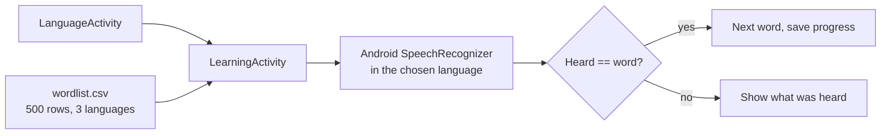

# Victoria-Accent_Training

An Android app for practicing pronunciation in English, Spanish and Italian. It shows a word, you say it, and you move on only when the phone understood you.

## The problem

Vocabulary apps check whether you can read or type a word. They don't check whether a listener would understand you saying it, which is the part that matters in a conversation.

## What I built

A Java app that uses Android's speech recognizer as the listener.

- Choose a language, each with its own level
- A word appears. Hold the microphone button and say it
- If the recognizer hears exactly that word, you advance. If not, the app shows what it heard so you can hear your own mistake
- 500 words per language, 30 words per level, progress saved per language

## Architecture

## Design decisions

- The speech recognizer is the judge. If a general-purpose recognizer set to the target language understands the word, a person probably would too. It needs no pronunciation model of my own.
- Push to talk. Recognition starts on touch down and stops on release, so the recognizer only gets the one word and background noise matters less.
- The app shows what was heard on a miss. "You said X" is more useful feedback than "wrong".
- A few homophones are mapped by hand ("2" to "to", for example), because the recognizer returns the more common spelling of a sound.
- Progress is a single counter per language in SharedPreferences. The level is derived from it.

## Building

Android Gradle Plugin 7.0.3, Gradle 7.0.2, target SDK 31. Open it in Android Studio and accept the upgrade assistant, or build with JDK 11.

Run it on a real phone with the Google app installed, since that provides the speech recognizer. The app asks for microphone permission on first use.

## Limits

It is a pass or fail check on whole words, not a score of how good the accent is. There is no audio playback of the correct pronunciation, and the app does not handle reaching the end of the 500 word list.
